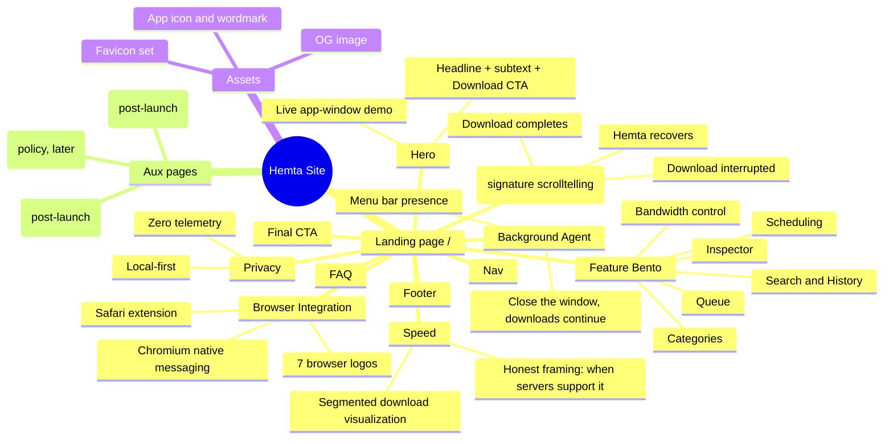

# Hemta Site — Sitemap, Mindmap & Section Plan

> Source of truth for the site's structure and per-section messaging.
> Copy strings here are working drafts; final copy is locked during build, section by section.
> Messaging must stay inside the honesty walls: HTTP/HTTPS on macOS only. No torrent/FTP/crawler/cloud/cross-platform implications, ever.

## 1. Mindmap

## 2. Page tree (V1)

| Route | Purpose | Status |
|---|---|---|
| `/` | The story: hero, recovery scrolltelling, kill-switch, browsers, desktop scene, sorting tree, use-cases, comparison, FAQ, dark finale (stats, privacy, marquee, CTA) | Built |
| `/features` | The reference: acceleration (speed viz lives HERE, not on home), recovery engine, queue & categories, search & inspector, bandwidth & scheduling, trust. No duplication with home by design. | Built; sharpening pass pending |
| `/download` | Conversion page: CTA, install steps, requirements | Built (real dmg link pending) |
| `/privacy` | Privacy manifesto in plain words; legal policy text pending | Built |
| `/changelog`, `/support` | Post-launch. Nav/footer links appear only when pages exist. | Not yet |

## 3. Section-by-section plan

Layout-family diversity is a hard rule: no two sections share the same layout family.
Family used is noted per section. Eyebrow budget for ~11 sections: max 3 total (hero counts as 1).

### 3.1 Nav
- Sticky, 64px, one line: wordmark left; Features, How it works, FAQ center/right; `Download` button far right.
- Background: translucent + backdrop-blur once scrolled (macOS-material nod), transparent at top.
- CTA intent lock: the word "Download" is the ONLY conversion label used anywhere on the page (nav, hero, final CTA).

### 3.2 Hero — layout family: asymmetric split
- **Left**: headline, subtext, single primary CTA (+ quiet "Requires macOS 13+" caption is NOT in hero; it lives with the final CTA).
- **Right**: a live animated Hemta app window (real component preview, see architecture doc §6) showing 3 downloads: one accelerating with visible segments, one queued, one completing.
- Working headline: **"Downloads that finish."**
  - Alternates to test: "Your downloads, off the leash." / "The last download manager your Mac needs." (pick one at build, never all)
- Working subtext (18 words, within the 20-word cap): "Hemta captures downloads from your browser, accelerates them, and recovers them through network drops, sleep, and restarts."
- Hero stack: headline, subtext, 1 CTA. Three text elements, under the 4-element cap. No trust strip, no tagline, no version badge.

### 3.3 Recovery Story — layout family: pinned scrolltelling (GSAP)
The signature section. The one thing visitors remember.
- Pinned viewport sequence driven by scroll scrub:
  1. A large download progress bar advancing ("8.4 GB of 12 GB", mono numerals).
  2. Wi-Fi drops (system-style indicator dims; progress halts). Copy beat: "Your Wi-Fi doesn't care about your download."
  3. The browser-world outcome ghosts in faintly: "Download failed." Then Hemta's outcome takes over: state chip flips to Recovering, then Downloading.
  4. Bar completes to 12 GB. Copy beat: "Hemta picks up exactly where it stopped. Not from zero."
- States shown must match the real product lifecycle: Downloading, Interrupted, Recovering, Completed.
- Reduced motion: the sequence collapses to a static 3-frame storyboard.

### 3.4 Speed — layout family: full-width visualization
- One file splitting into parallel segment lanes, each filling concurrently, merging into a completed file. GSAP-driven, scrub or in-view play-once.
- Numbers in mono. No fake benchmark claims; framing is structural ("multiple connections instead of one"), not "8x faster".
- Honesty note rendered small below viz: acceleration applies when servers support ranged requests; Hemta falls back to a normal download when they don't.

### 3.5 Browser Integration — layout family: logo row + flow line
- Real SVG logos (simple-icons): Safari, Chrome, Edge, Brave, Arc, Vivaldi, Opera. Logos only, no category labels.
- One-line story above: click download in your browser, Hemta takes it from there.
- Small print honesty: Safari via extension; Chromium browsers via native messaging. (Feature fact from the brief, one sentence, not a diagram.)

### 3.6 Background Agent — layout family: split feature (text + visual), mirrored from hero
- Story: start a download, close the window, keep working; Hemta keeps going. Reopen later, everything's current.
- Visual: menu bar glimpse + a closing window while a progress indicator persists.
- This is the second (and last) permitted image+text split on the page.

### 3.7 Feature Bento — layout family: bento grid
- Exactly 6 cells for 6 real features: Queue, Categories, Search & History, Inspector, Bandwidth control, Scheduling.
- Cell sizes asymmetric (e.g. 2 large + 4 small). At least 2 cells get real visual treatment (mini component previews or tinted panels), not six white text cards.
- Each cell: feature name + one concrete sentence. No "powerful", no "seamless".

### 3.8 Privacy — layout family: typographic statement
- Spacious, near-empty section. Large type: **"Hemta doesn't phone home."**
- Supporting line: your downloads, history, and habits stay on your Mac. Zero telemetry. No account.
- Links to `/privacy`. No cards, no icons, no illustration. The restraint is the design.

### 3.9 FAQ — layout family: accordion (shadcn)
Honest answers, including scope walls:
- Which macOS versions? (fact from app team before launch)
- Which browsers? (the 7, with the extension/native-messaging note)
- Does it do torrents/FTP? (No. Hemta is HTTP/HTTPS only, on purpose.)
- What happens if my Mac sleeps mid-download?
- Is my data sent anywhere? (No. Local-first.)
- Pricing (fact needed from owner before launch)

### 3.10 Final CTA — layout family: centered closer
- The one place a centered composition is used. Headline, `Download` button, requirements caption (macOS version, Apple silicon/Intel as applicable).
- Optional: notarization/Gatekeeper trust note if accurate at launch.

### 3.11 Footer
- Wordmark, minimal columns: Product (Features, FAQ), Legal (Privacy), Contact.
- No version strings, no locale strips, no decoration.

## 4. Copy register

One register across the page: plain, confident, concrete. Short declaratives. Technical nouns are allowed (segments, connections, checkpoint), marketing filler is not (banned: seamless, blazing, unleash, supercharge, next-gen, revolutionize).
Numbers that appear (file sizes, speeds) are illustrative demo values inside the component previews, not claims; they must look organic (8.4 GB, 34.2 MB/s), never round marketing numbers.

## 5. Content dependencies (need from owner/app repo before launch)

- [ ] Final app name treatment / logo or wordmark
- [ ] Supported macOS version floor + architectures
- [ ] Pricing model (free/paid/trial) for FAQ + CTA
- [ ] Real app screenshots (to replace/augment component previews when the app UI stabilizes)
- [ ] Download artifact URL (dmg) + notarization status
